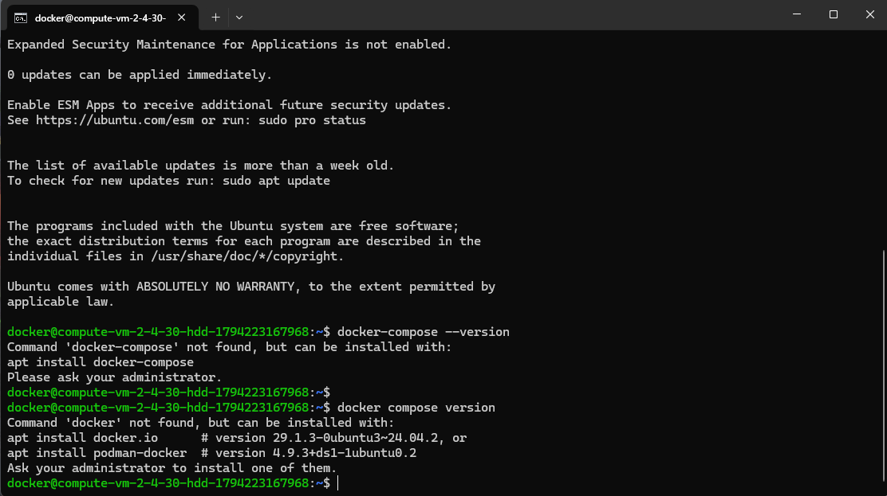
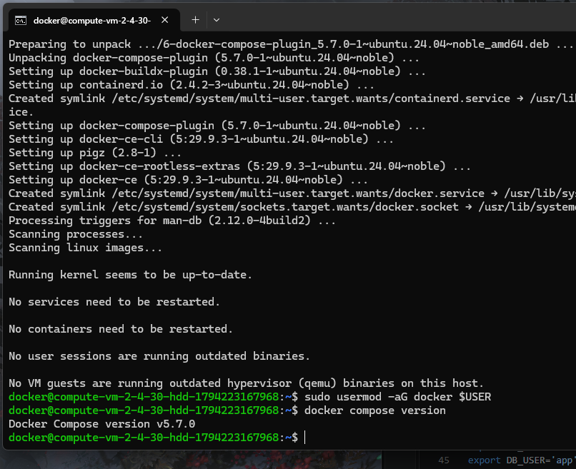
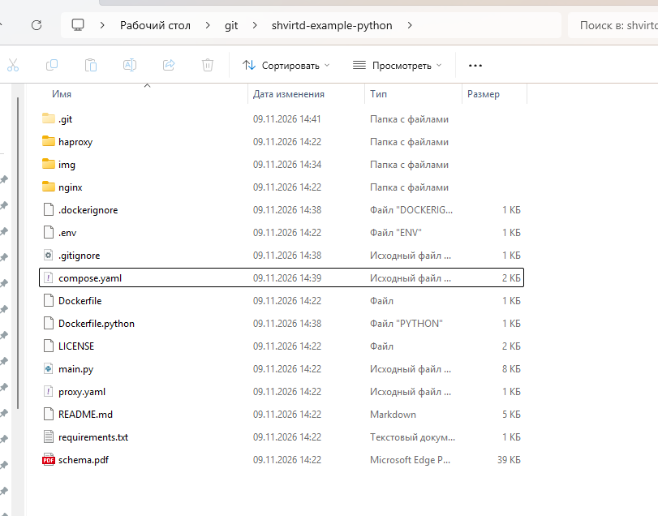
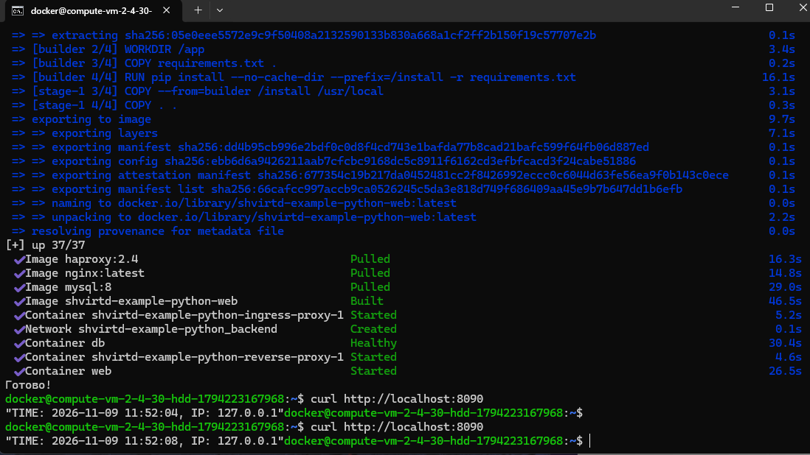
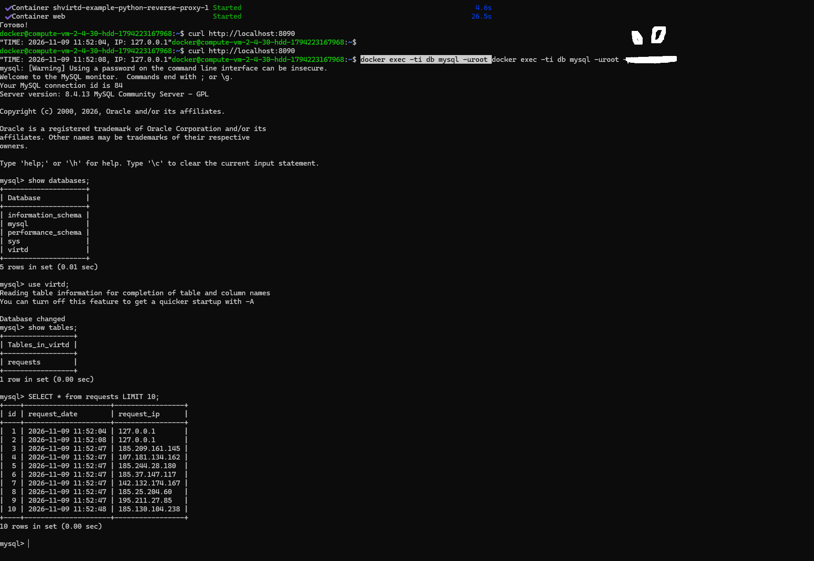
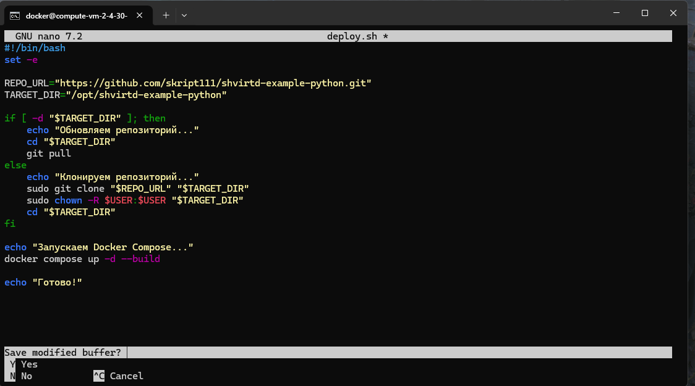
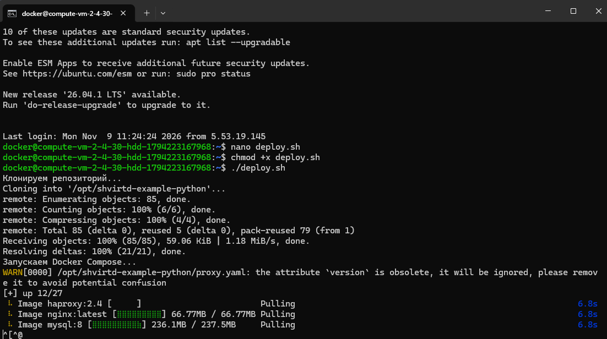
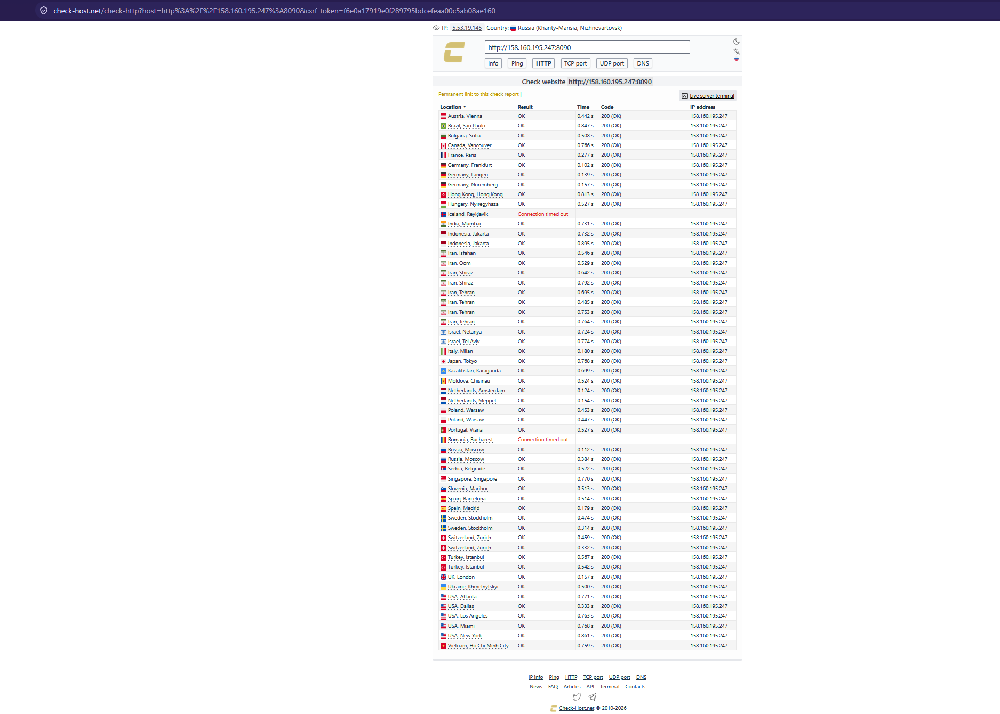
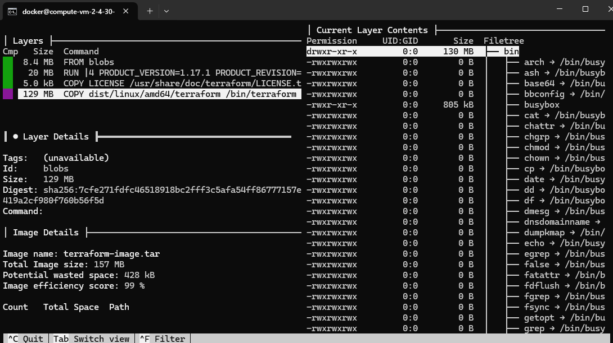
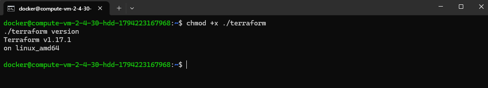

# Домашнее задание к занятию «Оркестрация группой Docker контейнеров на примере Docker Compose» - Шичков Евгений

**Ссылка на fork-репозиторий с проектом:** [https://github.com/Skript111/shvirtd-example-python](https://github.com/Skript111/shvirtd-example-python)

---

### Задание 0. Проверка версий Docker

В ходе выполнения задания убедился, что устаревшая утилита `docker-compose` (с дефисом) в системе отсутствует. Впоследствии был установлен современный плагин `docker compose` (без дефиса) версии v5.7.0.

**Доказательство (отсутствие старого и установка нового):**

---

### Задание 1. Создание Dockerfile.python

Создал файл `Dockerfile.python` на основе базового образа `python:3.12-slim`. Использовал **multistage-сборку** (два этапа: `builder` для установки зависимостей и финальный `stage-1` для запуска). Обязательно применил конструкцию `COPY . .` и `CMD ["uvicorn", "main:app", "--host", "0.0.0.0", "--port", "5000"]`. 
Также добавил файлы `.dockerignore` и `.gitignore` для исключения лишних файлов.

**Доказательство (файлы проекта и логи сборки):**

---

### Задание 3. Настройка Docker Compose и локальный запуск

Создал файл `compose.yaml`, в котором через директиву `include` подключил существующий `proxy.yaml`.
Настроил сервисы:
- **web:** собирается из `Dockerfile.python`, работает в bridge-сети `backend` с фиксированным IP `172.20.0.5`.
- **db:** образ `mysql:8`, работает в сети `backend` с фиксированным IP `172.20.0.10`.
Для секретных данных использовал уже существующий файл `.env`.

Запустил проект локально. Команда `curl -L http://127.0.0.1:8090` (скриншот выше ) успешно возвращает время и IP-адрес.
Подключился к БД контейнера, выполнил SQL-запросы и убедился, что таблица `requests` успешно создалась и хранит записи с IP-адресами.

**Доказательство (работа curl и SQL-запрос):**

---

### Задание 4. Развертывание в Yandex Cloud

Запустил виртуальную машину в Yandex Cloud (Ubuntu 24.04) и установил на нее Docker.
Написал bash-скрипт `deploy.sh`, который автоматически клонирует репозиторий в каталог `/opt` и запускает проект целиком через `docker compose up -d --build`.

**Доказательство (скрипт и его выполнение):**

После запуска проверил доступность сервиса извне с помощью сервиса `check-host.net` по адресу `http://158.160.195.247:8090`. Все проверки (HTTP-код 200) пройдены успешно.

**Доказательство (проверка доступности):**

---

### Задание 6. Извлечение бинарного файла Terraform

Скачал образ `hashicorp/terraform:latest`. С помощью утилиты `dive` и команды `docker save` проанализировал слои образа. Нашел слой размером 129 MB, содержащий бинарный файл `/bin/terraform`.

Извлек бинарник из архива и проверил его работоспособность на ВМ. Команда `./terraform version` успешно вывела версию `Terraform v1.17.1`.

**Доказательство (анализ через dive и проверка версии):**

